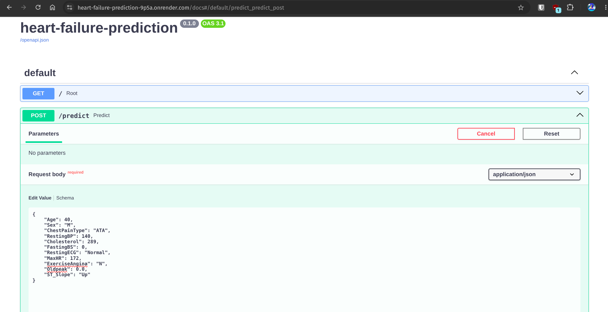
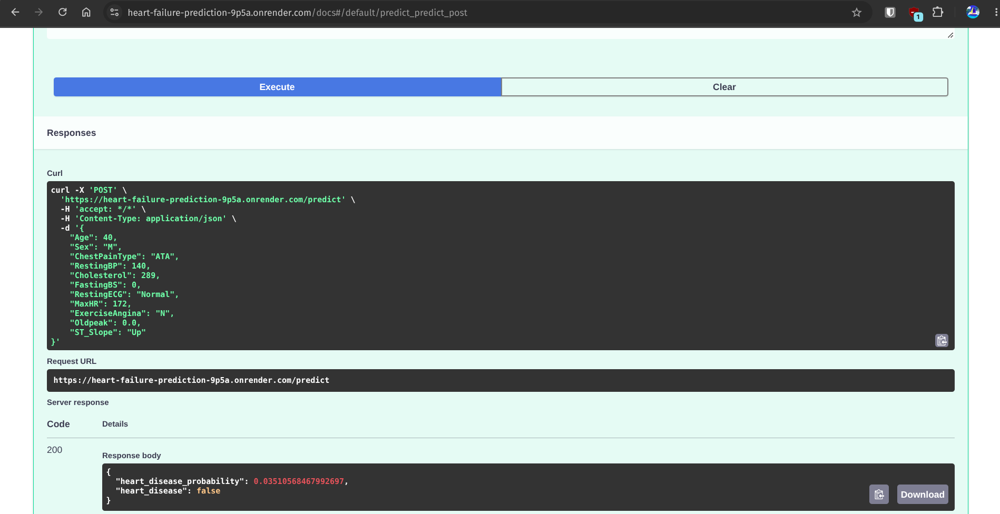

# Heart Failure Prediction

This is a machine learning project that explores a heart disease dataset, trains a
logistic regression classifier, and serves heart failure predictions through a FastAPI
endpoint.

## Live demo

The API is deployed on Render:

- **Live API:** [Open the deployed service](https://heart-failure-prediction-9p5a.onrender.com)
- **Interactive API docs:** [Try a prediction in Swagger UI](https://heart-failure-prediction-9p5a.onrender.com/docs)

The service root returns API information; use `/docs` to submit a prediction.

### Prediction

*Example patient details entered in the deployed API.*


*The API's heart disease probability and classification.*

## Project contents

- `notebook.ipynb` — exploratory data analysis, feature preparation, model
  evaluation, and ROC curve.
- `data/heart.csv` — dataset used for training the model.
- `train.py` — trains the model on the dataset and saves the vectorizer
  and classifier pipeline to `model.bin`.
- `predict.py` — validates prediction requests and serves the model.
- `test.py` — sends a sample request to a running API.
- `Dockerfile` — builds an image for serving the saved model.

The target column is `HeartDisease` (`0` means no heart disease and `1` means
heart disease). The model uses the following features: age, sex, chest-pain type, resting blood
pressure, cholesterol, fasting blood sugar, resting ECG, maximum heart rate,
exercise-induced angina, oldpeak, and ST-segment slope.

## Requirements

- Python 3.12 or newer
- [uv](https://docs.astral.sh/uv/)

Install the project's dependencies from the repository root:

```bash
uv sync --locked
```

## Explore and evaluate

Open `notebook.ipynb` in Jupyter or VS Code and run its cells from top to
bottom. It checks data quality, examines feature and target distributions,
splits the data into training, validation, and test sets, and evaluates
logistic regression. The notebook's validation split reports ROC AUC; the
saved deployment model is subsequently trained on the full dataset by
`train.py`.

## Train the model

From the repository root:

```bash
uv run python train.py
```

This reads `data/heart.csv` and writes the trained pipeline to `model.bin` in
the repository root. Run training again whenever the dataset or model
configuration changes.

## Run the prediction API locally

Make sure `model.bin` exists, then start the development server:

```bash
uv run uvicorn predict:app --host 0.0.0.0 --port 9696 --reload
```

- API information: <http://127.0.0.1:9696/>
- Interactive API documentation: <http://127.0.0.1:9696/docs>
- Prediction endpoint: `POST http://127.0.0.1:9696/predict`

Example request:

```bash
curl -X POST http://127.0.0.1:9696/predict \
  -H "Content-Type: application/json" \
  -d '{
    "Age": 40,
    "Sex": "M",
    "ChestPainType": "ATA",
    "RestingBP": 140,
    "Cholesterol": 289,
    "FastingBS": 0,
    "RestingECG": "Normal",
    "MaxHR": 172,
    "ExerciseAngina": "N",
    "Oldpeak": 0.0,
    "ST_Slope": "Up"
  }'
```

The response contains a `heart_disease_probability` between 0 and 1 and a
`heart_disease` boolean. The boolean uses a probability threshold of 0.5.
Input categories and numeric constraints are documented in the interactive
API docs.

## Test against the local API

With the API running in one terminal, run this from the repository root in a
second terminal:

```bash
uv run python test.py
```

The script sends an example patient request and prints the probability and
classification. It raises an error if the API returns an unsuccessful HTTP
status. `test.py` targets `http://localhost:9696`; to test the Render deployment
instead, use the interactive docs above or change the URL in `test.py` to your
Render service's `/predict` endpoint.

## Run with Docker

The Docker image serves the existing `model.bin`; build or retrain it locally
before building the image if needed:

```bash
uv run python train.py
docker build -t heart-failure-prediction .
docker run --rm -p 9696:9696 heart-failure-prediction
```

Then open <http://127.0.0.1:9696/docs> to try the endpoint.